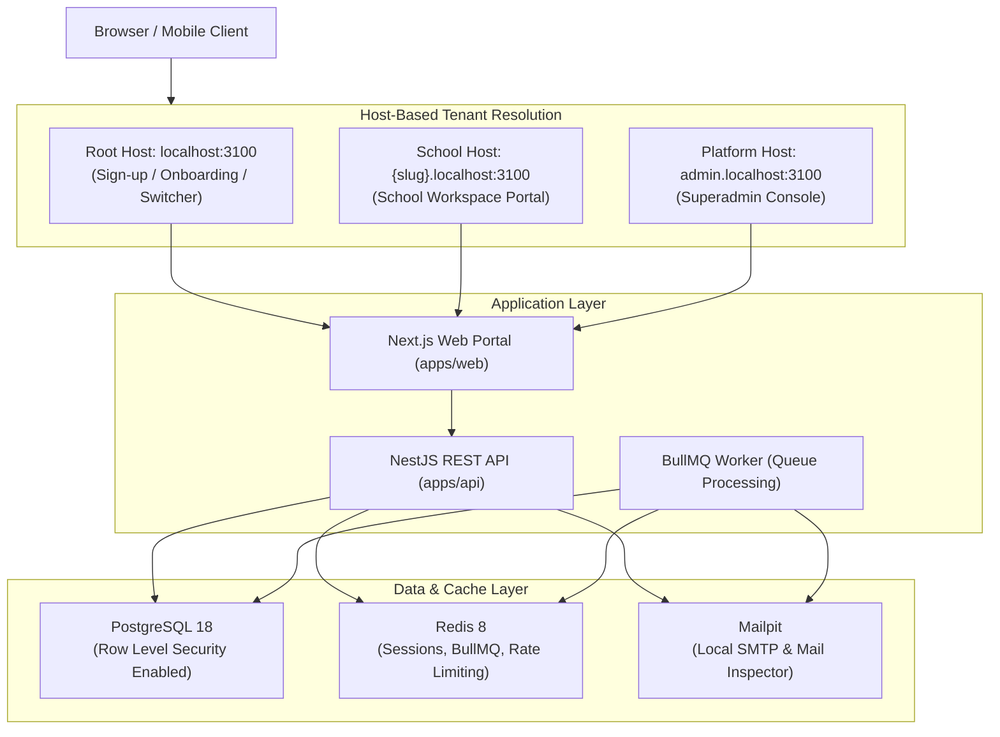

# EduFlow

> **Enterprise-Grade Multi-Tenant School Management Platform**  
> Engineered with PostgreSQL Row Level Security (RLS), 3-tier database separation, host-based tenant isolation, and granular role-based access control (RBAC).

---

## 🏛 Architecture Overview

EduFlow is structured as an enterprise monorepo using **Turborepo** and **pnpm workspaces**. It enforces tenant isolation at both the application and database tiers:



### Core Architecture Pillars

1. **Row Level Security (RLS)**:
   - Tenant data is partitioned by `school_id` across shared database tables.
   - Session context is injected transactionally via `set_config('app.school_id', ..., true)` and `set_config('app.user_id', ..., true)`.
   - Missing or empty contexts fail closed by matching zero records.
2. **Three-Tier Database Roles**:
   - `eduflow_owner`: Owns tables and schema; executes migrations via Prisma CLI (`prisma migrate deploy`). Never used by runtime API.
   - `eduflow_app`: Executes normal API requests. Bound by `NOBYPASSRLS`.
   - `eduflow_system`: Used for authentication, session verification, tenant resolution, and platform operations. Granted explicit `system_access` RLS policies.
3. **Immutable Audit Trail**:
   - `audit_logs` table protected with PostgreSQL triggers preventing `UPDATE`, `DELETE`, and `TRUNCATE`.
4. **Non-Escalation & Last-Owner Invariants**:
   - Administrators can only assign permissions they hold themselves.
   - A school must maintain at least one active `school_owner` at all times.

---

## 📁 Repository Structure

```
eduflow/
├── apps/
│   ├── api/                   # NestJS REST API with Prisma, BullMQ, and Pino
│   │   ├── prisma/            # Schema, migrations, and seed datasets
│   │   ├── src/               # Modules: auth, tenancy, schools, members, roles, audit, platform
│   │   └── test/              # E2E & integration test suites
│   └── web/                   # Next.js 15 multi-tenant App Router web portal
│       └── src/               # Adaptive layouts, tenant dashboards, member & role managers
├── packages/
│   ├── types/                 # Shared Zod schemas, permission catalog, system roles, DTOs
│   ├── tsconfig/              # Shared TypeScript compiler configurations
│   └── eslint-config/         # Shared ESLint 9 flat configuration rules
├── infra/
│   ├── docker/                # Multi-stage Dockerfiles for API and Web
│   ├── postgres/              # Database initialization and role configuration SQL
│   └── redis/                 # Redis configuration
├── docs/                      # Architectural specifications & ERD documentation
│   ├── multi-tenancy.md       # Multi-tenant isolation and security architecture
│   ├── database.md            # Database schema ERD, constraints, and triggers
│   └── architecture.md        # System architecture and security guidelines
├── scripts/
│   └── setup-env.mjs          # Automatic environment template setup script
├── compose.yaml               # Docker Compose configuration (PostgreSQL, Redis, Mailpit)
├── turbo.json                 # Turborepo task pipeline definition
└── pnpm-workspace.yaml        # pnpm workspace package definitions
```

---

## ⚡ Quickstart & Local Setup

### 1. Prerequisites

- **Node.js**: `v24.x` (LTS recommended)
- **pnpm**: `v10.x`
- **Docker & Docker Compose**

### 2. Environment Setup

Run the automated environment setup script to copy environment templates:

```bash
pnpm setup
```

This populates:

- `.env` (Docker compose port and password configurations)
- `apps/api/.env` (API runtime and database connection strings)

### 3. Start Backing Infrastructure

Launch PostgreSQL, Redis, and Mailpit in the background:

```bash
pnpm infra:up
```

_Endpoints:_

- **PostgreSQL**: `127.0.0.1:5433`
- **Redis**: `127.0.0.1:6380`
- **Mailpit UI**: `http://localhost:8026` (SMTP: `127.0.0.1:1026`)

### 4. Database Migrations & Seeding

Apply migrations with the owner role and seed development data:

```bash
pnpm db:migrate
pnpm db:seed
```

### 5. Start Development Servers

Start all applications in watch mode via Turborepo:

```bash
pnpm dev
```

_Available web portals (configure local DNS or `/etc/hosts` if needed):_

- **Root Account Portal**: [http://localhost:3100](http://localhost:3100)
- **Sample School**: [http://greenfield.localhost:3100](http://greenfield.localhost:3100)
- **Platform Console**: [http://admin.localhost:3100](http://admin.localhost:3100)
- **API Swagger / Endpoints**: [http://localhost:4000/api/v1](http://localhost:4000/api/v1)

---

## 🧪 Testing & Verification

Integration and E2E tests execute against a dedicated, isolated test database (`eduflow_test`) and Redis database `15`:

```bash
# Run unit & schema tests
pnpm test

# Run full integration & multi-tenant isolation E2E suites
pnpm test:e2e

# Run TypeScript typechecks
pnpm typecheck

# Run linter
pnpm lint
```

---

## 🐳 Containerized Production Deployment

To build and run all services in production mode:

```bash
docker compose --profile app up --build
```

This automatically initiates the `migrate` container first, applies database updates, and boots both `api` and `web` containers once database migrations complete.

---

## 📖 Additional Documentation

- [Multi-Tenancy Guide](docs/multi-tenancy.md)
- [Database Schema & ERD](docs/database.md)
- [System Architecture](docs/architecture.md)
