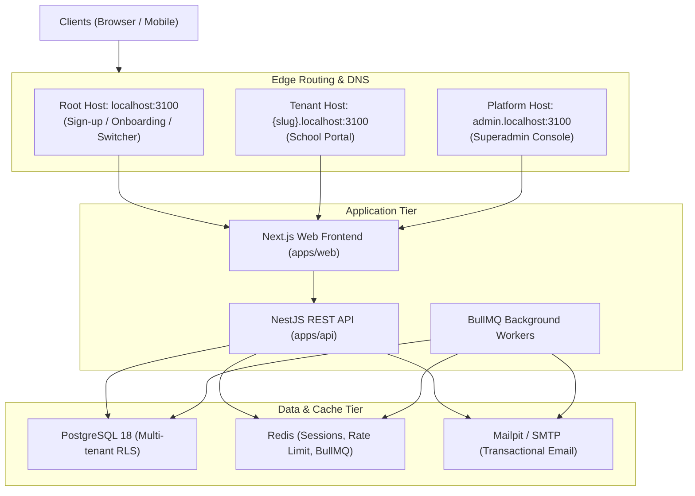

# EduFlow System Architecture

EduFlow is a cloud-native, multi-tenant Education Management SaaS platform engineered with high isolation guarantees and enterprise-grade security.

## High-Level Topology

## Security Model

1. **Authentication**:
   - Cookie-based HTTP-only session tokens.
   - Tokens stored in the database as SHA-256 digests; raw tokens are never persisted.
   - Automatic host binding: A session initiated on one host cannot be used across different host types.
   - Brute-force protection via Redis login throttling (`LOGIN_MAX_FAILURES`, `LOGIN_LOCKOUT_MINUTES`).
   - CSRF protection requiring custom request headers or origin validation.

2. **Authorization & RBAC**:
   - Permission-based access control with granular scopes (`own`, `assigned`, `all`).
   - System roles (`school_owner`, `school_admin`, `teacher`, `student`, `guardian`, `accountant`, `librarian`, `hr_staff`, `platform_owner`).
   - Tenant-level custom roles with scoped permissions.
   - Non-escalation invariant: users cannot grant or revoke roles possessing privileges broader than their own.
   - School owner invariant: a school must always retain at least one active `school_owner`.

3. **Background Jobs & Email**:
   - Asynchronous queuing powered by BullMQ on Redis.
   - Transactional email dispatch for email verification, password reset, and member invitations.
