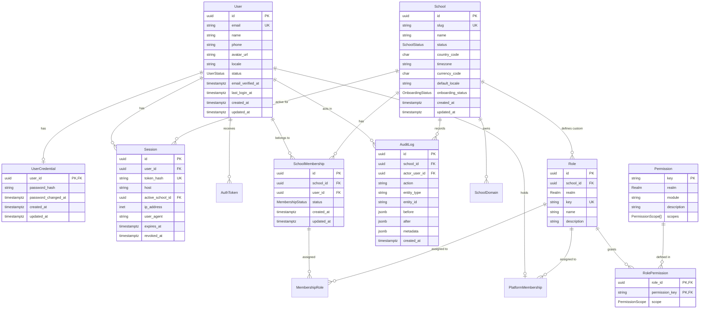

# Database Architecture & Conventions

EduFlow uses PostgreSQL 18 with Prisma ORM as its primary data layer.

## Design Conventions

1. **UUIDv7 Primary Keys**:
   - All primary keys are UUIDv7 (`uuidv7()`), providing natural chronological ordering and high B-tree indexing efficiency without database lock contention.
2. **Naming Conventions**:
   - Tables and columns are named in `snake_case` in the database schema.
   - Prisma models and fields are defined in `PascalCase` and `camelCase` respectively, mapped via `@@map` and `@map`.
3. **Defense-in-Depth Constraints**:
   - Check constraints enforce valid email formats, lowercased domains, valid ISO codes (country `[A-Z]{2}`, currency `[A-Z]{3}`), and session expiry timestamps.
   - Database triggers enforce cross-table integrity (e.g., ensuring roles assigned to school memberships belong to the same school or are global system roles).
4. **Append-Only Audit Trail**:
   - `audit_logs` has triggers preventing `UPDATE`, `DELETE`, and `TRUNCATE`, ensuring non-repudiation.

## Entity Relationship Diagram (ERD)

## Security & Isolation Triggers

- `audit_logs_append_only`: Blocks any `UPDATE` or `DELETE` on the `audit_logs` table.
- `audit_logs_no_truncate`: Blocks `TRUNCATE` operations on `audit_logs`.
- `role_permissions_integrity`: Validates that the granted permission exists within the role's realm and uses an allowed scope.
- `membership_roles_integrity`: Ensures assigned roles are either platform-independent system roles or custom roles belonging to the same tenant.
- `platform_memberships_integrity`: Confirms platform members only hold platform-realm roles.
