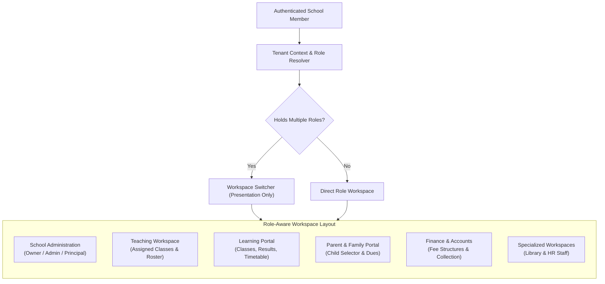

# EduFlow Role-Aware School Workspaces

EduFlow delivers role-aware workspaces within a single school subdomain (e.g., `greenfield.eduflow.com`). The application dynamically adapts its navigation, dashboard widgets, and data boundaries to match the authenticated user's active roles and permissions.

---

## 1. Architectural Principles

1. **Single Application, Multiple Experiences**:
   Different roles (Admin, Teacher, Student, Guardian, Accountant) operate within the same school subdomain, sharing common institutional branding while experiencing purpose-built workspaces.
2. **Server-Enforced Authorization**:
   Hiding a navigation link or button is a UI convenience. Every API endpoint enforces role and permission checks independently on the server.
3. **Strict Data Scoping**:
   - Teachers only access their assigned classes, sections, and students.
   - Students only access their personal academic records.
   - Guardians only access their explicitly linked children.
   - Accountants only access financial records, without authority to alter grades or results.
4. **Real Data Integrity**:
   All metrics and widgets are powered by authentic database services. Features that belong to future milestones (e.g., Library circulation or HR payroll) display an honest, informative planned-feature status rather than misleading placeholder figures.

---

## 2. Workspace Experiences



### A. School Owner & Administrator (`owner`, `admin`)
- **Dashboard**:
  - Total students, teachers, staff members.
  - Class and section structure overview.
  - Daily school-wide attendance percentage.
  - Operations schedule (pending admissions, upcoming exams).
  - Recent append-only audit trail events.
- **Navigation**:
  - Overview, Academic Management, Members & Staff, Roles & Permissions, Audit Trail, Settings.

### B. Principal & Academic Coordinator (`principal`)
- **Dashboard**:
  - Class and section distribution.
  - Faculty statistics and academic performance tracking.
  - Exam scheduling and result publication approvals.
- **Navigation**:
  - Academic Overview, Classes & Sections, Teachers, Results, Approvals.

### C. Teacher (`teacher`)
- **Dashboard**:
  - Assigned classes and sections count.
  - Total students within assigned sections.
  - Attendance marking status for today.
  - Daily teaching timetable (periods, times, subjects, rooms).
  - Class rosters with Class Teacher badges.
  - Faculty notices.
- **Navigation**:
  - Overview, My Classes, My Students, Timetable, Attendance, Assignments, Enter Marks.
- **Data Boundary**:
  - Governed by `TeacherAssignment`. Unassigned classes and students are never displayed.

### D. Student (`student`)
- **Dashboard**:
  - Personal enrolled class, section, roll number, and admission number.
  - Attendance percentage and standing badge.
  - Enrolled subjects list with credit hours and subject types.
  - Daily personal class schedule.
  - Published examination marks and letter grades.
  - School announcements.
- **Navigation**:
  - Dashboard, My Profile, My Timetable, My Subjects, My Attendance, Homework, My Results.
- **Data Boundary**:
  - Governed by `userId = current_user_id()`. Students cannot access any peer records.

### E. Parent / Guardian (`guardian`)
- **Child Selector**:
  - Multi-child dropdown and quick-selector pills (e.g., Rahim Hasan — Class 8A, Ayesha Hasan — Class 5B).
  - Selecting a child dynamically updates all dashboard widgets to reflect that child's verified records.
- **Dashboard**:
  - Selected child's attendance rate.
  - Daily timetable and upcoming examination schedule.
  - Academic marks and grade evaluations.
  - Outstanding tuition fee balance and online payment reminder.
  - Teacher and school notices.
- **Navigation**:
  - Overview, My Children, Attendance, Academic Results, Timetable, Fee Statements.
- **Data Boundary**:
  - Governed by `GuardianStudent`. Zero trust: Client-supplied student IDs are verified against explicit guardian relationships; unlinked access attempts are denied with `403 Forbidden`.

### F. Accountant (`accountant`)
- **Dashboard**:
  - Total fees collected, today's counter collection, outstanding invoices count.
  - Class fee structures count.
  - Recent payment transactions table with admission numbers and receipt status.
- **Navigation**:
  - Overview, Fee Structures, Invoices, Payments, Financial Reports.
- **Data Boundary**:
  - Accountants cannot modify student marks or academic structures without explicit academic permissions.

### G. Librarian & HR Staff (`librarian`, `hr_staff`)
- **Dashboard**:
  - Real registered staff counts.
  - Clear, honest planned-feature status outlining upcoming capabilities (book barcode circulation, leave approvals, payroll).

---

## 3. Multiple Role Support & Workspace Switcher

Users holding multiple roles in the same school (e.g., **Teacher** + **Parent**, or **Admin** + **Accountant**) can seamlessly switch views:

1. **Presentation Separation**:
   Switching workspace changes presentation only. It does not grant or revoke permissions on the backend.
2. **Zero-Trust Backend**:
   The backend independently checks the user's school membership, assigned roles, and permission scopes for every API request.
3. **Tenant Invariant**:
   Switching workspace stays strictly within the resolved school tenant (`school_id`).
4. **Preference Persistence**:
   The user's preferred workspace is saved per school in browser local storage (`eduflow_active_ws_<schoolId>`) and supported via URL query parameters (`/?workspace=<type>`).

---

## 4. Frontend Component Hierarchy

```
apps/web/src/
├── components/
│   └── workspace/
│       ├── WorkspaceLayout.tsx       # Root responsive shell (sidebar + header + content)
│       ├── WorkspaceSidebar.tsx      # Desktop fixed & mobile slide-out navigation
│       ├── WorkspaceHeader.tsx       # Breadcrumbs, switcher, notification bell, profile
│       ├── WorkspaceSwitcher.tsx     # Role-view switcher dropdown for multi-role members
│       ├── WorkspaceNavigation.tsx   # Permission-filtered navigation items
│       ├── Breadcrumbs.tsx           # Dynamic hierarchy breadcrumbs
│       ├── NotificationMenu.tsx      # Reusable notifications dropdown
│       ├── UserProfileMenu.tsx       # Avatar, role pills, settings, logout
│       ├── widgets/
│       │   ├── StatCard.tsx          # Reusable counter & metric cards
│       │   ├── AttendanceSummary.tsx # Progress bar & standing badge
│       │   ├── TimetableWidget.tsx   # Period-by-period class schedule
│       │   ├── AnnouncementList.tsx  # School notices & alerts
│       │   ├── RecentActivities.tsx  # Audit trail feed
│       │   ├── ChildSelector.tsx     # Guardian multi-child toggle
│       │   └── EmptyState.tsx        # Planned-module roadmap card
│       └── dashboards/
│           ├── AdminDashboard.tsx
│           ├── TeacherDashboard.tsx
│           ├── StudentDashboard.tsx
│           ├── GuardianDashboard.tsx
│           ├── AccountantDashboard.tsx
│           ├── LibrarianDashboard.tsx
│           └── HRDashboard.tsx
└── config/
    ├── workspace-navigation.ts       # Route catalogs & permission requirements
    └── dashboard-config.ts           # Workspace metadata, badges, and accents
```

---

## 5. Security & Isolation Guarantees

1. **Subdomain Isolation**:
   Sessions are bound to hostnames. Subdomain routing resolves tenant context automatically before any route handler executes.
2. **PostgreSQL 18 RLS**:
   All database operations run inside transactions with session settings `app.school_id` and `app.user_id`, guaranteeing cross-tenant data leakage is impossible at the database engine level.
3. **Access Denied Graceful Handling**:
   If a user directly modifies the URL query to request an unauthorized workspace (`/?workspace=admin`), the frontend displays a secure "Workspace Access Restricted" screen with a one-click return to their primary authorized portal.
